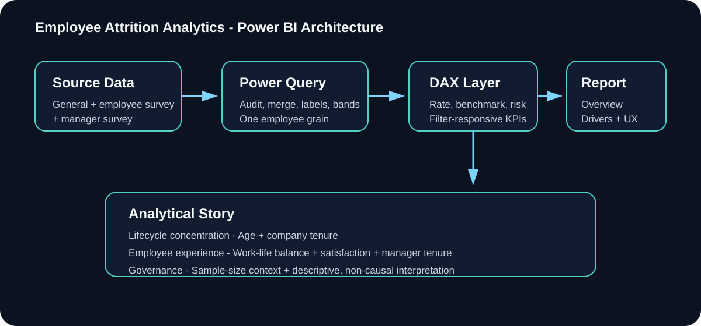

# Employee Attrition Power BI Dashboard - Engineering Case Study

OSYSTIC ENGINEERING CASE STUDY - PUBLIC SHOWCASE - SANITIZED - PORTFOLIO-SAFE

This repository contains no client identity, no raw employee dataset, no confidential PBIX delivery file, no private screenshots, no private conversations, no payment information, and no proprietary delivery package.

## Company showcase classification

| Attribute | Public classification |
|---|---|
| Publisher | OSYSTIC |
| Artifact type | Analytics engineering case study / capability proof |
| Platform | Microsoft Power BI |
| Domain | Employee attrition analytics |
| Engagement | Completed dashboard engineering and analytics project |
| Publication model | Sanitized public showcase with independent Git history |
| Confidential delivery | Excluded and retained privately |
| Causality claim | None |
| Intended use | Portfolio, proposals, technical due diligence, capability review |

## What this repository is

An anonymized engineering case study for a Power BI dashboard designed to identify where employee attrition is concentrated and which employee characteristics and experience variables provide the clearest descriptive story.

The engagement required source-data auditing, Power Query integration, analytical-grain decisions, DAX design, statistical prioritization, correlated-variable reduction, interaction design, sample-size context and replication-oriented documentation.

## Outcome

The completed analytical baseline covered 4,410 employees and identified 711 attrition employees, an overall attrition rate of 16.12%.

The strongest presentation story was an employee-lifecycle pattern rather than one isolated variable:

- Age 18-24: 39.18% attrition
- Company tenure 0-1 years: 34.88%
- Age 18-24 combined with company tenure 0-1 years: 60.47%, or 78 of 129 employees
- Single employees: 25.53%
- Bad work-life balance: 31.38%
- Low environment satisfaction: 25.21%
- Low job satisfaction: 22.91%
- 0-1 years with current manager: 28.32%

These are descriptive associations, not causal findings.

## Public vs private boundary

| Area | This public showcase | Confidential engineering repository |
|---|---|---|
| Visibility | Public | Private |
| Purpose | Portfolio / capability proof | Engineering source of truth |
| PBIX implementation | Not included | Retained privately |
| Replication DOCX | Not included | Retained privately |
| Raw employee data | Not included | Controlled/private |
| Client identity | Not included | Protected |
| Private screenshots / conversations | Not included | Controlled |
| Commercial / payment information | Not included | Controlled |
| Sanitized methodology | Included | Full context retained |
| Safe to share publicly | Yes | No |

This repository is not a fork, mirror or delivery export. It has independent sanitized history.

## Engineering architecture

Employee source datasets
  -> data-quality audit
  -> Power Query integration
  -> one employee-grain analytical model
  -> DAX measure layer
  -> driver prioritization
  -> interactive Power BI report
  -> QA and replication documentation

## Engineering highlights

- Employee-grain consolidation across three sources sharing the same 4,410 EmployeeIDs.
- Power Query for reusable row-level shaping and DAX for filter-responsive measures.
- Correlated lifecycle variables interpreted together instead of being presented as independent causes.
- Sample-size context retained for the strongest age-tenure interaction.
- Small missing-value volumes preserved as null instead of imputed.
- Compact dropdown slicers, synchronized filters, cross-filtering and tooltips for presentation use.
- Replication documentation covering source preparation, model decisions, DAX, visuals and QA.
- Descriptive language governance to avoid causal overstatement.

## Technology

Microsoft Power BI | Power Query / M | DAX | data modelling | interactive dashboards | descriptive analytics | data-quality validation | business intelligence

## What is intentionally not claimed

This showcase does not claim:

- that any variable causes employee attrition;
- individual employee attrition prediction;
- a production HR decisioning system;
- publication rights for the confidential PBIX or raw datasets;
- that the public repository reproduces the private implementation;
- that descriptive associations imply future behavior;
- audited HR, legal or compliance conclusions.

## Read more

- Full case study: case-study.md
- Technical overview: docs/technical-overview.md
- Validation evidence: docs/validation-evidence.md
- Engineering lessons: docs/lessons-learned.md
- Disclosure boundary: docs/disclosure-boundary.md
- Publication record: docs/publication-record.md
- Public showcase runbook: docs/runbook.md
- Publication and reuse notice: NOTICE.md

OSYSTIC - AI, automation, analytics and software engineering.
